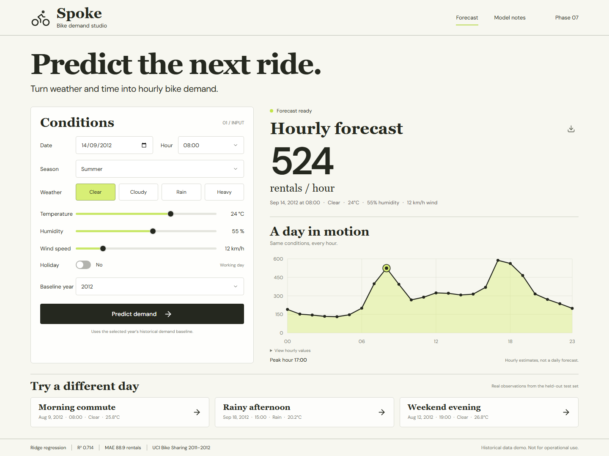

# Spoke — Bike demand studio

A minimal web app for **Phase 7: Make Predictions Using the Trained Model**. Enter weather and time conditions, predict total bike rentals for one hour, and compare real unseen examples with observed demand.

The original `Bike_Rental_Demand_Project.ipynb` is preserved. This application deploys its **final Ridge(alpha=10.0) model**, rather than the earlier log-target linear regression.



**[Complete ML project report](docs/PROJECT_REPORT.md)** · **[Deployment guide](docs/DEPLOYMENT.md)** · **[Phase 8 submission status](submission/PHASE_8.md)**

## Project overview

The UCI hourly Bike Sharing dataset contains 17,379 observations from Washington, D.C. in 2011–2012. The workflow covers data quality checks, exploratory analysis, feature engineering, chronological training, regression evaluation and a real prediction interface.

| Model | MAE | RMSE | R² |
|---|---:|---:|---:|
| Initial linear regression with log target | 125.74 | 186.88 | 0.2816 |
| Final Ridge with hour indicators and rush-hour interaction | **88.92** | **117.95** | **0.7138** |

The final model is evaluated on the last 3,476 records. This period was also used during approach refinement; independent future-period validation remains future work. The report includes the dataset dictionary, leakage prevention, six EDA/evaluation figures, actual prediction errors and historical-model limitations.

Public hosting is being prepared on Streamlit Community Cloud after Render requested card verification. The React interface and saved Python model are preserved through a small hosting adapter; the FastAPI/Docker version remains available. The [Phase 8 status](submission/PHASE_8.md) records verified deployment evidence; the screenshot above is local evidence.

## Run on Windows

The environment, saved model, and production frontend have been prepared in this folder. Open PowerShell here and run:

```powershell
powershell -ExecutionPolicy Bypass -File .\start.ps1
```

Open **http://127.0.0.1:8000**. Keep the terminal open; press Ctrl+C to stop. The launcher installs missing dependencies and builds missing frontend files on a fresh machine. Requirements: Python 3.13 and Node.js 22.12 or newer (Node 22 LTS recommended). First-time setup requires internet access; prediction does not.

If port 8000 is already occupied, run the server manually with `--port 8001` and open that address. The production app and API share the same port.

## Why FastAPI + React?

FastAPI serves the existing Python/scikit-learn model directly, validates inputs, and provides browsable API documentation. React + Vite provides a polished, responsive interface. A full MERN stack would need an additional Python inference service anyway, and this app has no need for MongoDB or account storage. One service serves both the built frontend and the model API.

## What you can demonstrate

- Weather, date, hour, season, temperature, humidity, wind, holiday, and historical year inputs.
- A real numerical estimate of total system-wide rentals **per hour**, not per station or per day.
- A 24-hour what-if profile with weather held constant; hover for values or expand the accessible table.
- Three examples from the chronological held-out test set, with observed count and absolute prediction error.
- Clear stale-result labeling when inputs change. Predict again to update the result.
- CSV export containing inputs and 24 hourly estimates; an observed value appears only for the matching example hour.
- Model notes with genuine metrics, preprocessing, dataset source, and model limitations.
- Responsive desktop and mobile layouts; locally bundled fonts.

## Model integration

`scripts/prepare_model.py` reproduces notebook cell 9 from the same UCI `hour.csv`, trains on the first 13,903 records, and evaluates on the last 3,476. It checks the reproduced metrics against the notebook before writing artifacts:

| Metric | Reproduced result |
|---|---:|
| MAE | 88.9194 rentals |
| MSE | 13,911.6807 |
| RMSE | 117.9478 rentals |
| R² | 0.713831 |

The model uses **53 features**. Inference explicitly rebuilds the same ordered columns:

1. The selected baseline maps 2011 → `yr=0`, 2012 → `yr=1`.
2. The date supplies month and weekday, with Sunday encoded as zero. Weekends and holidays are non-working days.
3. Temperature uses `(Celsius + 8) / 47`, humidity uses `percentage / 100`, and wind uses `km/h / 67`.
4. Season, weather, weekday, hour, and month use the final notebook's dropped-reference one-hot encoding.
5. The rush-hour interaction is 1 on working days at hours 7, 8, 9, 17, 18, or 19.
6. Ridge predicts the original count directly. Clip negative predictions to zero and round only the displayed rental count. No scaler or log inverse is used.

**Dataset documentation correction:** current UCI metadata identifies hourly Celsius normalization as `(t − (−8)) / (39 − (−8))` and seasons as winter=1, spring=2, summer=3, fall=4. The notebook's plot labels call season 1 spring, and the older archive README describes temperature differently. The UI follows the current hourly metadata; the numeric training data and feature encoding remain unchanged. Held-out example inputs invert this same conversion, so their deployed predictions reproduce the notebook exactly.

For new dates, choose a historical baseline explicitly. The model learned Washington, D.C.'s 2011–2012 demand, not current demand in Pakistan or another city. MAE is an aggregate error metric, not a confidence interval. Heavy weather has very few training observations. These limits are explained in the app.

## Files

```text
Bike_Rental_Demand_Project.ipynb  original notebook (unchanged)
backend/main.py                  FastAPI endpoints + production static serving
backend/prediction.py            input validation, ordered features, inference
frontend/src/                    React UI and responsive styles
artifacts/ridge_model.joblib     trusted estimator + feature order
artifacts/metadata.json          metrics, split, provenance and file hashes
artifacts/scenarios.json         unseen scenarios with observed demand
data/hour.csv                   locally cached UCI source data
scripts/prepare_model.py         reproducible model export
tests/test_prediction.py         numerical parity and API checks
tests/browser-check.mjs          real browser interaction checks and screenshots
submission/                     screenshots, scenario results, example CSV
docs/design/                    generated visual reference
Dockerfile                      one-service production deployment
start.ps1                       Windows launcher
```

## Verify or retrain

From the project root:

```powershell
.venv\Scripts\python.exe -m pytest tests\test_prediction.py -q
.venv\Scripts\python.exe scripts\prepare_model.py
```

The script uses the cached CSV when present. To download a fresh copy, move the cached CSV aside first. Only load trusted joblib files; the app does not accept model uploads.

To reproduce the EDA, both model results, report figures and the complete held-out prediction table:

```powershell
.venv\Scripts\python.exe -m pip install -r requirements-analysis.txt
.venv\Scripts\python.exe scripts\analyze_project.py
```

Outputs are written to `docs/figures/`, `docs/analysis-results.json` and `docs/test-predictions.csv`. The preserved notebook includes an extraneous `a` expression in the exploratory baseline cell; use the scripts above for a clean run-from-start workflow.

Build the frontend:

```powershell
cd frontend
npm.cmd ci
npm.cmd run build
```

With the backend running on port 8000, browser verification from the root:

```powershell
frontend\node_modules\.bin\playwright.cmd install chromium
node tests\browser-check.mjs
```

For development, start the Python service and run `npm.cmd run dev` inside `frontend`. Visit http://127.0.0.1:5173; Vite proxies `/api` to port 8000. Rebuild the frontend for production after changes.

## API

Interactive documentation: http://127.0.0.1:8000/docs

- `GET /api/health` — loaded-model health
- `GET /api/model` — model metrics and preprocessing metadata
- `GET /api/scenarios` — held-out examples and actual values
- `POST /api/predict` — hourly prediction and profile

Example request:

```json
{
  "date": "2012-09-14",
  "hour": 8,
  "season": 3,
  "weather": 1,
  "temperature_c": 24,
  "humidity": 55,
  "wind_kmh": 12,
  "holiday": false,
  "baseline_year": 2012
}
```

## Deploy as one container

For the free Community Cloud deployment, use `cloud/streamlit_app.py` with Python 3.13 and `cloud/requirements.txt`. See the [deployment guide](docs/DEPLOYMENT.md). Its component uses the same Python predictor and does not require a separate API server. The prebuilt React component in `cloud/frontend/` is regenerated with `npm.cmd run build:cloud` from `frontend` after UI changes.

For a standalone FastAPI deployment, use the Docker container:

```sh
docker build -t spoke .
docker run --rm -p 8000:8000 spoke
```

The container serves the React build and API on the same origin, runs as a non-root user, and includes the saved model. It accepts the host's `PORT` environment variable. Any container host can use this Dockerfile; route public traffic to that port and use `/api/health` as the health check. No API key or database is required. The production image passed [Linux build and runtime verification on GitHub Actions](https://github.com/HmdNvd/Bike-Rental-Demand/actions/runs/38612696294), including all six model/API tests and a known prediction. See the [Phase 8 status](submission/PHASE_8.md) for public hosting progress.

## Submission

See `submission/PHASE_7.md` for screenshots, real scenario outputs, and a concise explanation you can use in the internship submission.

Dataset: Hadi Fanaee-T (2013), *Bike Sharing*, UCI Machine Learning Repository, [DOI 10.24432/C5W894](https://doi.org/10.24432/C5W894), CC BY 4.0. [Current dataset metadata](https://archive.ics.uci.edu/dataset/275/bike+sharing+dataset).
