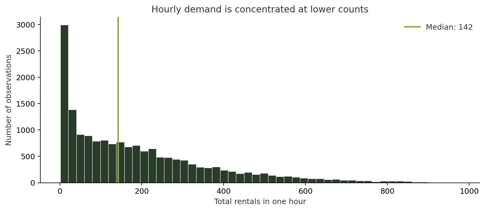
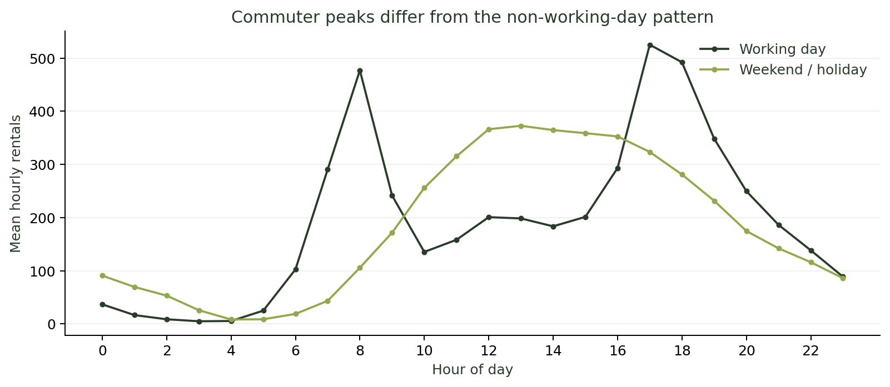
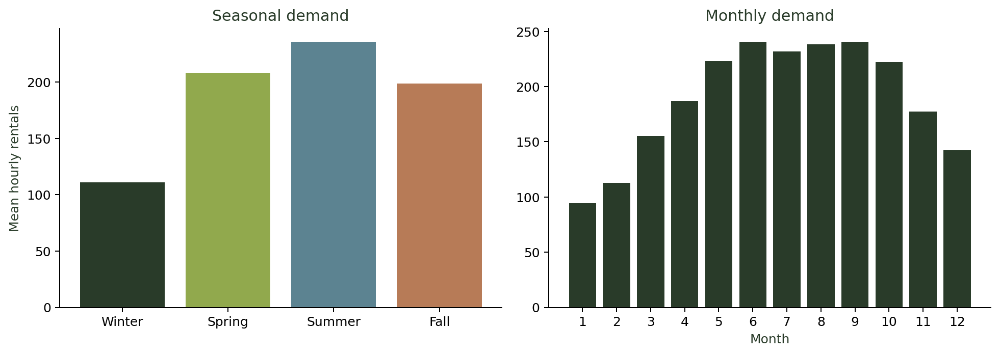
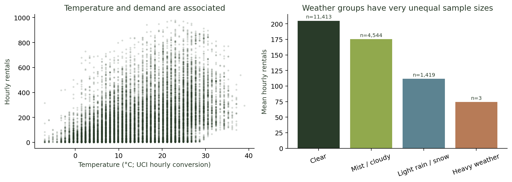
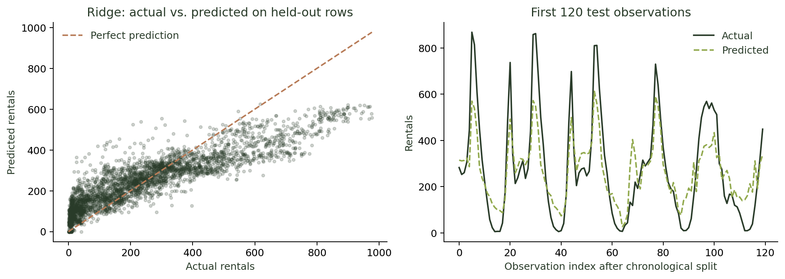
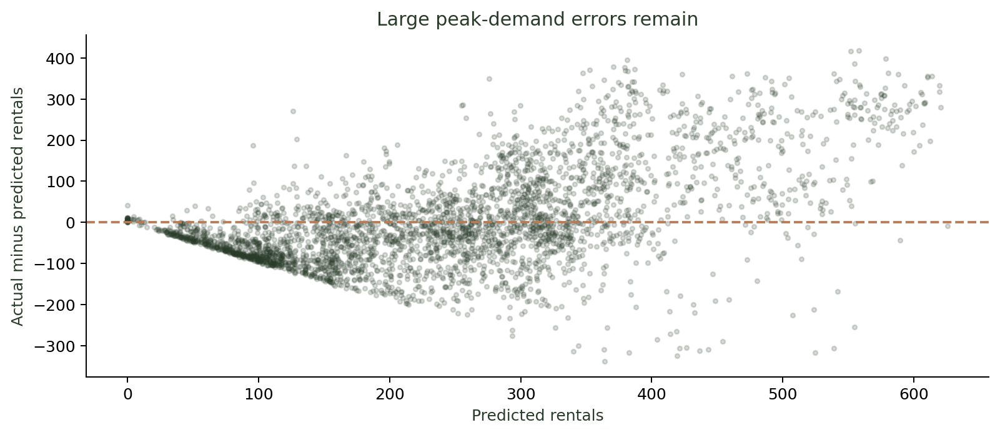
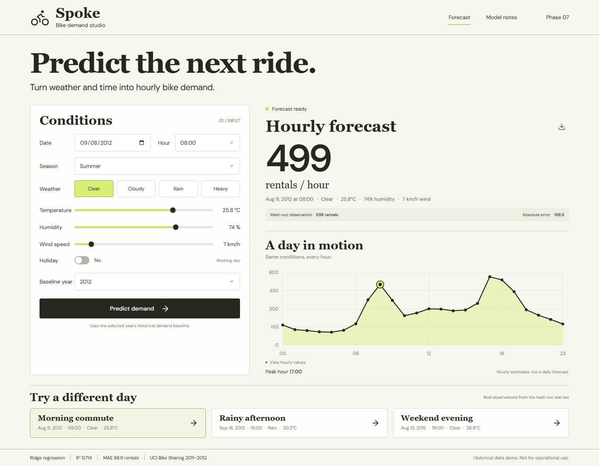
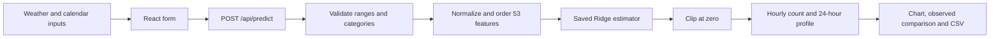

# Spoke: Bike Rental Demand Prediction

**AI/ML internship project · Phases 1–8 · 14 October 2026**

[Repository](https://github.com/HmdNvd/Bike-Rental-Demand) · [Setup instructions](../README.md) · [Deployment guide](DEPLOYMENT.md) · [Phase 7 examples](../submission/PHASE_7.md)

## 1. Problem and objective

Bike-sharing demand changes with commuting patterns, seasons and weather. This project predicts the **total number of rentals in one hour across the Capital Bikeshare system in Washington, D.C.**, using calendar and weather conditions. It is a supervised regression problem: the target is a numerical count, not a class.

The objective is to demonstrate a complete data science workflow: inspect and prepare historical data, investigate demand patterns, fit and compare models, evaluate numerical errors, and serve the final estimator through a working prediction interface. A potential use is exploring expected demand under different conditions; operational fleet planning would require newer data and stronger validation.

The application, **Spoke**, uses React for user input and visualization and FastAPI for validation and Python inference. Users receive an hourly estimate, a constant-weather 24-hour what-if profile, and observed comparisons for selected held-out examples.

## 2. Dataset and provenance

Source: Hadi Fanaee-T (2013), *Bike Sharing*, UCI Machine Learning Repository, [DOI 10.24432/C5W894](https://doi.org/10.24432/C5W894), [current metadata](https://archive.ics.uci.edu/dataset/275/bike+sharing+dataset), CC BY 4.0.

The project uses **hour.csv**, downloaded from the same UCI ZIP used by the original notebook. The cached CSV is committed for reproducibility. The original notebook is preserved as `Bike_Rental_Demand_Project.ipynb`. Model metadata records the data and notebook hashes, feature order, estimator version and evaluation results.

| Property | Verified value |
|---|---:|
| Observations | 17,379 hourly records |
| Original columns | 17 |
| Date coverage | 1 January 2011 – 31 December 2012 |
| Missing cells | 0 |
| Duplicate complete rows | 0 |
| Target minimum / maximum | 1 / 977 rentals |
| Mean / median hourly target | 189.46 / 142 rentals |

The period contains unrecorded hourly slots: no missing cells does not mean every calendar hour is present. The project preserves the observed rows without inventing demand values or filling absent hours.

### Data dictionary

| Field | Meaning and treatment |
|---|---|
| `instant` | Row identifier; excluded from modeling |
| `dteday` | Calendar date; excluded as a raw feature; date-derived fields retained |
| `season` | UCI codes: 1 winter, 2 spring, 3 summer, 4 fall |
| `yr` | Historical demand baseline: 0 for 2011, 1 for 2012 |
| `mnth`, `hr` | Month 1–12 and hour 0–23 |
| `holiday` | Binary public-holiday flag supplied by the dataset |
| `weekday` | Day of week, Sunday=0 through Saturday=6 |
| `workingday` | 1 when the day is neither a weekend nor a holiday |
| `weathersit` | 1 clear, 2 mist/cloudy, 3 light rain/snow, 4 heavy weather |
| `temp` | Normalized temperature |
| `atemp` | Normalized apparent temperature; excluded in the notebook pipeline |
| `hum` | Humidity divided by 100 |
| `windspeed` | Wind speed divided by 67 |
| `casual`, `registered` | Component rental counts; excluded to prevent target leakage |
| `cnt` | Total rental count; regression target |

`cnt = casual + registered`; using either component to predict the total would expose information unavailable before rentals occur. Neither component is accepted by the inference API.

## 3. Data preparation

1. Load the CSV and check its structure, missing values and duplicate rows. No imputation or duplicate removal was needed.
2. Exclude `instant`, raw `dteday`, `casual`, `registered` and `atemp`, matching the original project.
3. Separate `cnt` from the predictors.
4. Preserve chronological row order for training and evaluation.
5. Encode categories and temporal features according to the model being evaluated.

### Initial model preparation

The initial approach represents hour and month using sine and cosine pairs, encodes season/weekday/weather using one-hot indicators with a reference category omitted, and yields **22 input features**. The target is transformed with `log1p`. A `StandardScaler` is fitted on the training rows only. Linear regression predicts in log space, followed by `expm1` to recover counts for evaluation.

### Final model preparation

The final approach uses one-hot indicators for season, weather, weekday, hour and month. With reference categories omitted, it adds a working-day rush-hour interaction:

```text
rush_hour_commute = workingday AND hour in {7, 8, 9, 17, 18, 19}
```

The result is **53 features**, in the exact order stored with the estimator. This model fits the original count target directly. It uses neither the initial model's scaler nor its log-target transformation. Predicted counts are clipped at zero for evaluation and serving.

### User-friendly units and documentation reconciliation

At inference, Celsius is converted with `(temperature_c + 8) / 47`, humidity with `humidity_percent / 100`, and wind with `wind_kmh / 67`. The temperature formula follows the current UCI metadata specifically describing hourly observations. The original archive README describes temperature differently, and the original notebook's seasonal plot labels call code 1 spring. New report figures and UI labels follow current UCI metadata: winter=1, spring=2, summer=3, fall=4. Numeric training values and encodings are unchanged.

The API converts dates to month and Sunday-zero weekday and derives the working-day flag from weekend/holiday status. The baseline year and season remain explicit scenario inputs. The interface does not automatically fetch weather or determine public holidays.

## 4. Exploratory data analysis

The following descriptive analysis uses the full historical dataset, as the original notebook did. These figures show associations rather than causal effects. `scripts/analyze_project.py` reproduces every figure and saves exact summary values in `analysis-results.json`.

### Demand is right-skewed

The mean count (189.46) exceeds the median (142). Most observations have lower rental counts, with a smaller number of busy periods extending toward the maximum of 977. This motivated investigating a log-target baseline, although the final count-scale model performs better on the reported evaluation.



### Working-day and non-working-day patterns differ

Working days show distinct morning and evening commuting peaks. Weekends and holidays have a broader daytime pattern. A single sine/cosine cycle cannot represent all of these shapes flexibly; explicit hour indicators and a working-day rush-hour interaction were introduced in the final model.



### Seasonal demand varies

Using current UCI season labels, summer has the highest mean hourly demand (**236.02**) and winter the lowest (**111.11**). Month and season capture recurring patterns, but these averages also mix changes between 2011 and 2012; they should not be interpreted as isolated causal seasonal effects.



### Weather and temperature are associated with demand

Normalized temperature has a Pearson correlation of approximately **0.405** with demand. Mean rentals are lower in light rain/snow than in clear conditions. Weather groups have very unequal sample sizes:

| Weather group | Observations | Mean hourly rentals |
|---|---:|---:|
| Clear / few clouds | 11,413 | 204.87 |
| Mist / cloudy | 4,544 | 175.17 |
| Light rain / snow | 1,419 | 111.58 |
| Heavy weather | 3 | 74.33 |

Only **three** heavy-weather observations exist, all in training. They cannot support a reliable general assessment of demand in storms. The app warns when that category is selected.



## 5. Training and model selection

Both approaches use the same chronological 80/20 split. There is no random shuffle:

| Partition | Rows | Exact boundary |
|---|---:|---|
| Training | 13,903 | 2011-01-01 00:00 through 2012-08-07 11:00 |
| Held-out period | 3,476 | 2012-08-07 12:00 through 2012-12-31 23:00 |

The split occurs within 7 August, which explains why that date appears in both partitions. Keeping later observations out of model fitting is more relevant to a time-based prediction task than randomly mixing future and past records.

The selected estimator is **Ridge regression with alpha=10.0**. Ridge penalizes large coefficients and fits the expanded indicator feature set. The value 10.0 is the notebook's chosen setting, not a claimed cross-validation optimum. No parameter search or rolling time-series validation was performed in this project.

The final approach changes both feature representation and estimator/target treatment. Its improvement therefore cannot be attributed solely to Ridge regularization. No ablation experiment was performed to isolate each change.

## 6. Evaluation results

All regression metrics below are computed on the original rental-count scale and reproduced from the source data. Rounded values match the notebook outputs.

| Approach | Features | MAE | MSE | RMSE | R² |
|---|---:|---:|---:|---:|---:|
| Linear regression, cyclical time, scaled inputs, log target | 22 | 125.74 | 34,923.55 | 186.88 | 0.2816 |
| Ridge alpha=10, categorical time, rush-hour interaction, count target | 53 | **88.92** | **13,911.68** | **117.95** | **0.7138** |

MAE is the mean absolute difference between predicted and actual hourly counts. RMSE weights large errors more heavily. R² measures improvement over predicting the evaluation set's mean; it is **not classification accuracy**. The final model's MAE is about 29.3% lower than the initial approach's MAE.

The original notebook additionally thresholded the initial regression output to report a binary demand classification exercise. That result is not the deployed model's regression performance and is not used to advertise prediction accuracy.



The scatter plot shows deviations from the perfect-prediction line. The sequence plot follows the first 120 observed test records, not a guarantee that every calendar hour is present. Residuals show that large errors remain, particularly around busy periods.



**Validation limitation:** the notebook used this evaluation period while comparing and refining approaches, and full-dataset EDA informed feature design. It is therefore not an untouched final test of a previously frozen modeling decision. A stronger next iteration would select features/parameters using rolling validation inside the training period and evaluate once on an additional unseen future period.

## 7. Predictions on unseen observations

The app includes three genuine records from the held-out period. Their full-precision input measurements are stored in `artifacts/scenarios.json`. The UI rounds labels for readability without changing the underlying example values.

| Scenario | Date and hour | Prediction | Actual | Absolute error using unrounded prediction |
|---|---|---:|---:|---:|
| Morning commute | 2012-08-09 08:00 | 499.08 | 698 | 198.9 |
| Rainy afternoon | 2012-09-18 15:00 | 204.30 | 36 | 168.3 |
| Weekend evening | 2012-08-12 19:00 | 281.93 | 465 | 183.1 |

These examples are scenario demonstrations, not a representative sample used to calculate overall metrics. They deliberately retain the model's real errors. No observed outcome is invented for arbitrary user inputs. When a user edits an example, its observed comparison is hidden until the submitted inputs match that example again.



## 8. Application and model integration



The estimator is loaded once when FastAPI starts. Each request uses the saved model; deployment does not retrain on demand. Predictions retain floating-point precision, while the headline rental count is rounded for display. The chart varies the hour and holds all other conditions constant. It is a scenario profile, not a weather forecast or a daily-total prediction.

The production container builds React with Node and serves the resulting static files through FastAPI, alongside the API. A single service and domain are sufficient; the application does not need MongoDB, user accounts or an external model API.

## 9. Reproduction instructions

Requirements: Python 3.13, Node.js 22.12+ and Git. From a clean clone:

```powershell
git clone https://github.com/HmdNvd/Bike-Rental-Demand.git
cd Bike-Rental-Demand
python -m venv .venv
.venv\Scripts\python.exe -m pip install -r requirements-analysis.txt
.venv\Scripts\python.exe scripts\prepare_model.py
.venv\Scripts\python.exe scripts\analyze_project.py
.venv\Scripts\python.exe -m pytest tests\test_prediction.py -q
powershell -ExecutionPolicy Bypass -File .\start.ps1
```

The private repository requires access from the owner. `prepare_model.py` uses cached data when present and downloads the source ZIP when absent. It reproduces the final notebook pipeline, checks the original metrics, and exports the estimator, ordered features, metadata and scenarios. `analyze_project.py` independently reconstructs the baseline, evaluates the saved Ridge estimator and writes six figures, summary JSON and all 3,476 test predictions. These scripts are the supported run-from-start reproduction route; the preserved notebook contains exploratory code, including an extraneous `a` expression that interrupts a literal Run All.

The Windows launcher checks pinned dependency versions, prepares missing artifacts/build files and starts the server. The full API documentation is available at `/docs`. For development, run the backend on port 8000 and Vite inside `frontend` on port 5173.

## 10. Verification and deployment

Numerical/API tests reconstruct features independently and compare predictions, including reference categories and rare weather. They check the reproduced metrics, scenario endpoints, invalid values, future-date warnings and unknown API routes. Browser checks exercise predictions, observed comparisons, CSV export, stale inputs, warnings, dialog behavior, failure recovery, keyboard interaction and mobile overflow.

`render.yaml` defines a free Docker web service and `/api/health` as its health check. The Linux verification workflow builds the production image, runs the model tests inside it, starts the app, checks the frontend and confirms a known request returns 524 rentals. Refer to [the deployment guide](DEPLOYMENT.md) and [Phase 8 submission status](../submission/PHASE_8.md) for the actual verification and hosting state. Configuration alone is not evidence of a successful deployment.

## 11. Limitations and next work

- The model reflects 2011–2012 Washington, D.C. patterns. A 2026 date uses an explicit historical baseline; it does not establish contemporary or other-city demand.
- Observed weather is used retrospectively. Real advance demand forecasting would require weather forecasts and evaluation of their errors.
- There is no station-level demand, availability or rebalancing model.
- The count-scale additive Ridge model cannot represent every nonlinear effect or distinct hour-by-day interaction.
- MAE is an overall error summary, not an individual prediction interval. No calibrated uncertainty interval is supplied.
- Some categories, especially heavy weather, have inadequate coverage. Future year growth is not learned beyond the binary historical-year feature.
- Model development reused the reported evaluation period. Additional future-period validation is needed before operational claims.

Recommended next experiments are train-only EDA and rolling temporal validation, comparison with an hour-of-week historical baseline, more flexible hour-by-working-day features, tree-based regression, and evaluation on newer relevant data. Any model replacement should preserve the tested inference contract and report comparable chronological metrics.

## 12. Final result

The project connects the original data analysis to a fitted and persisted Ridge estimator, a validated Python prediction API, and a responsive interface. The reported final results are MAE **88.9194**, RMSE **117.9478** and R² **0.713831**. Source code, raw data, model artifacts, figures, prediction examples, reproduction scripts and deployment configuration are versioned together. Live hosting and its final screenshot are tracked separately so the submission does not confuse a local demonstration with a deployed application.

## References

1. Hadi Fanaee-T (2013). *Bike Sharing*. UCI Machine Learning Repository. https://doi.org/10.24432/C5W894
2. [UCI current field definitions](https://archive.ics.uci.edu/dataset/275/bike+sharing+dataset).
3. [Render Docker deployment](https://render.com/docs/docker), [Blueprint fields](https://render.com/docs/blueprint-spec), and [free-service limitations](https://render.com/docs/free).
4. Project evidence: `artifacts/metadata.json`, `artifacts/scenarios.json`, `docs/analysis-results.json`, `docs/test-predictions.csv`, and the original notebook.
