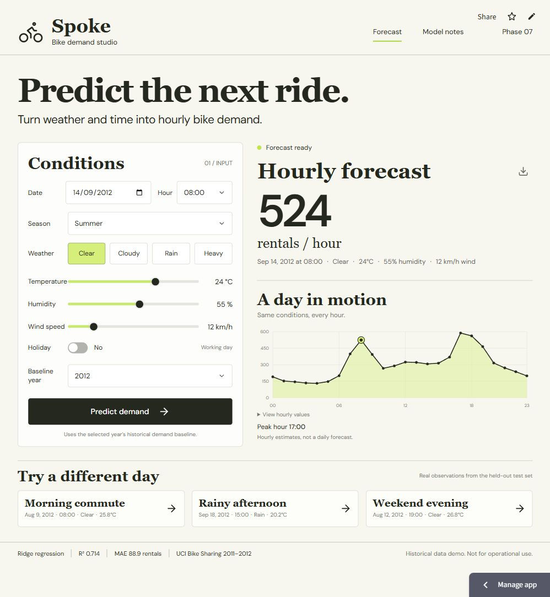

# Phase 8 — Documentation and Deployment

**Completed:** the prediction app is deployed at **[Spoke — Bike demand studio](https://spoke-bike-demand.streamlit.app/)** on Streamlit Community Cloud. The demo is public; the [GitHub repository](https://github.com/HmdNvd/Bike-Rental-Demand) remains private, so an evaluator needs separate repository access to inspect source code.

## Final working prediction screenshot

This is a browser capture of the deployed site. The capture includes selected inputs and the model result. The verified page URL is recorded separately in [live verification evidence](live/verification.json); the image does not include browser address-bar chrome.

Inputs: September 14, 2012, 08:00; summer; clear weather; 24°C; humidity 55%; wind 12 km/h; no holiday; 2012 baseline. Output: **524 rentals/hour**.

## Different test scenarios

| Live scenario | Predicted rentals/hour | Observed rentals | Absolute error |
|---|---:|---:|---:|
| [Morning commute](live/screenshots/02-morning-commute.png) | 499 | 698 | 198.9 |
| [Rainy afternoon](live/screenshots/03-rainy-afternoon.png) | 204 | 36 | 168.3 |
| [Weekend evening](live/screenshots/04-weekend-evening.png) | 282 | 465 | 183.1 |

Examples come from the chronological evaluation period. Errors use unrounded model outputs; displayed counts are rounded. These demonstrate actual predictions and honest comparisons, including imperfect predictions.

## Documentation and reproduction

- [Complete ML report](../docs/PROJECT_REPORT.md): problem, dataset, preprocessing, EDA, model, training, evaluation, predictions, limitations and reproduction.
- [Six report figures](../docs/figures/), [analysis summary](../docs/analysis-results.json), and [all 3,476 evaluation predictions](../docs/test-predictions.csv).
- [Deployment guide](../docs/DEPLOYMENT.md), pinned dependencies, model artifacts and reproducible scripts.
- [Live model notes screenshot](live/screenshots/05-model-notes.png).

## Deployment and verification

Hosting: Streamlit Community Cloud, Python 3.13, branch main, entry point cloud/streamlit_app.py. The React interface communicates with the same Python Predictor through a small Streamlit component. The standalone FastAPI/Docker deployment remains available.

Tested application code: commit 80a0045da95d6e7e90555d93ac8fb06165cc45fb. Its [GitHub Actions run](https://github.com/HmdNvd/Bike-Rental-Demand/actions/runs/38615816984) succeeded: Linux production Docker build, eight model/API/adapter tests, startup, health, frontend serving and known numerical inference. Later documentation-only commits preserve that tested application code.

Live browser checks confirmed the default prediction, all three scenarios and observed comparisons, a 24-hour profile, edited-input stale labeling, disabled export for stale results, successful recalculation (379 at the weekend example's 18:00), and model notes opening/closing. No browser console errors were captured during these checks. Local responsive testing covered the mobile dialog fix. A hosted CSV download was triggered, but automated download-event capture timed out; receipt of the hosted CSV is not claimed as verified here. The standalone CSV workflow was verified during Phase 7.

Render requested card verification despite its selected free plan. The owner selected Community Cloud instead; no payment details were entered and no paid service was created. Source changes pushed to main are picked up by Community Cloud.

## Project results

Final Ridge: MAE **88.9194**, RMSE **117.9478**, R² **0.713831** on the last 3,476 records. Initial log-target linear model: MAE 125.7422, RMSE 186.8784, R² 0.281609. The evaluation period was reused during model refinement, so these are development evaluation results, not an untouched final validation. The model reflects Washington, D.C. in 2011–2012 and is a historical demonstration.
